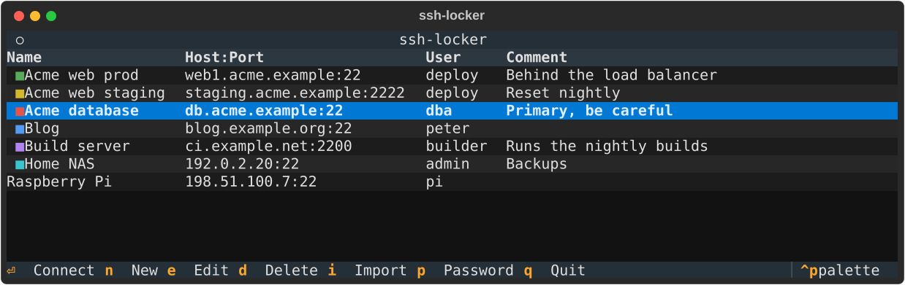

# ssh-locker

A terminal app for macOS that keeps your SSH connections in an encrypted vault
and starts a logged-in `ssh` session with one keypress.



## Install

With [Homebrew](https://brew.sh):

```sh
brew install ptrlarsson/tap/ssh-locker
```

The first install builds from source and takes a few minutes. Recent
Homebrew versions may ask you to trust the tap first; run the
`brew trust` command it prints. Upgrade later with `brew upgrade ssh-locker`.

From source (Python 3.11+):

```sh
python3 -m venv .venv
.venv/bin/pip install -e .
```

Run it with `.venv/bin/ssh-locker` (or put that on your `PATH`).

## Use

On first run you choose a master password. After that the app unlocks with
Touch ID, or asks for the master password if Touch ID is cancelled or
unavailable. It stays unlocked until you quit.

| Key      | Action                                        |
|----------|-----------------------------------------------|
| ↑ / ↓    | Select a connection                           |
| Enter    | Connect (the app closes when ssh ends)        |
| n        | New connection                                |
| e        | Edit the selected connection                  |
| d        | Delete the selected connection (asks first)   |
| i        | Import hosts from `~/.ssh/config`             |
| p        | Change the master password                    |
| q        | Quit                                          |

Each connection can have a colour, shown as a square before its name in the
list, and a comment, shown in its own column. Set both in New or Edit.

To change the master password you can also run
`ssh-locker --change-password`. Either way you must type the current
password, even if you unlocked with Touch ID. The vault is re-encrypted
with a fresh salt, and an existing Touch ID shortcut is updated (one you
deleted is not recreated).

Imported hosts have no password and connect with `ssh <alias>`, so your
`~/.ssh/config` settings (keys, jump hosts, …) still apply. Add a password
with Edit if you want one filled in automatically.

## Where the data lives and how it is protected

- The vault is `~/Library/Application Support/ssh-locker/vault.bin`
  (override the folder with `SSH_LOCKER_HOME`), mode 0600.
- Encryption is AES-256-GCM. The key comes from your master password via
  scrypt (N = 2^17, r = 8, p = 1, the OWASP minimum); the cost is recorded in
  the authenticated file header. Vaults from earlier versions are upgraded
  automatically the next time you unlock with the master password. The file
  holds no plaintext, and its folder is private to your user (0700).
- The master password must be at least 8 characters.
- Hosts and usernames that start with `-` or contain spaces are rejected, and
  ssh is always called with `--` before the destination, so a saved value can
  never be read as an ssh option. Control characters are rejected in all
  fields, and names and comments are always displayed as plain text.
- If the app ever crashes, the error report leaves out variable values, so a
  password cannot end up in your terminal scrollback.
- Saved passwords are handed to `ssh` through `SSH_ASKPASS`, reading an
  environment variable, so they never appear in the `ssh` command line.
  They are present in the `ssh` process's environment, readable only by
  your own user.
- Touch ID is a convenience: macOS does not let unsigned programs create
  biometric-protected Keychain items, so the app asks for Touch ID itself and
  keeps the vault key in a normal login-Keychain item
  (service `ssh-locker`). Another program running as you could read that
  item without a fingerprint. The master password remains the root of the
  encryption. The shortcut is created on first run (and replaced only if it
  stops matching the vault); to turn it off, delete that Keychain item and
  it will not be recreated.
- A saved password is offered to `ssh` once per connect
  (`NumberOfPasswordPrompts=1`), so a wrong saved password cannot trigger
  repeated login attempts. Note that with `ProxyJump` in an imported entry's
  config, the same saved password is also offered to the jump host.

## Development

```sh
.venv/bin/pip install -e '.[dev]'
.venv/bin/pytest
```

Regenerate the README screenshot (uses made-up data and a throwaway vault)
with `.venv/bin/python scripts/screenshot.py`.

## License

MIT, see [LICENSE](LICENSE).
